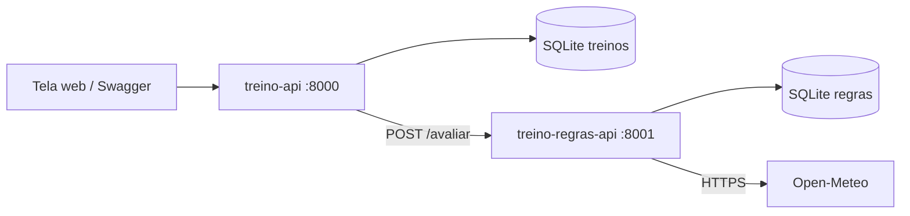

# Planejador de treinos ao ar livre

API para cadastrar treinos ao ar livre (corrida, caminhada, ciclismo e funcional) e saber se o clima no horário do treino está bom, pede atenção ou é melhor cancelar.

Este é o componente principal do projeto. Ele guarda os treinos num banco SQLite e, na hora de avaliar, chama a [treino-regras-api](https://github.com/JGPasinato/planejador_treinos_regras_api), que consulta o Open-Meteo e aplica as regras de clima.

## Tela

Ao abrir http://localhost:8000 aparece a tela do sistema, onde dá para cadastrar treinos, filtrar por tipo e status, avaliar o clima de cada treino, marcar como realizado e excluir. A tela é um HTML simples (`app/static/index.html`) que chama as rotas desta mesma API.

## Arquitetura



## API externa: Open-Meteo

| | |
| --- | --- |
| Site | [open-meteo.com](https://open-meteo.com/) |
| Licença | [CC BY 4.0](https://creativecommons.org/licenses/by/4.0/), uso gratuito com atribuição |
| Cadastro | Não precisa de cadastro nem de chave |
| Rotas usadas | `GET https://geocoding-api.open-meteo.com/v1/search` para achar a latitude e longitude da cidade |
| | `GET https://api.open-meteo.com/v1/forecast` para a previsão (temperatura, chuva e vento) no horário do treino |

Quem chama o Open-Meteo é a treino-regras-api. Os dados voltam para esta API já tratados, sem redirecionar o usuário para o site do Open-Meteo.

Documentação: https://open-meteo.com/en/docs e https://open-meteo.com/en/docs/geocoding-api

## Rotas

| Método | Rota | O que faz |
| --- | --- | --- |
| GET | `/` | Tela do sistema |
| GET | `/treinos` | Lista os treinos (filtros `tipo` e `status`, paginação com `skip` e `limit`) |
| POST | `/treinos` | Cadastra um treino |
| GET | `/treinos/{id}` | Mostra um treino |
| PUT | `/treinos/{id}` | Atualiza um treino |
| DELETE | `/treinos/{id}` | Remove um treino |
| POST | `/treinos/{id}/avaliar` | Consulta o clima no horário do treino e atualiza o status |
| GET | `/resumo` | Total de treinos por status e por tipo |
| GET | `/health` | Verifica se a API está no ar |

O `data_hora` do treino é o horário local da cidade. O Open-Meteo só tem previsão para os próximos 16 dias, então treinos mais distantes que isso não podem ser avaliados ainda.

## Como rodar

Suba primeiro a treino-regras-api na porta 8001. Depois, neste repositório:

```bash
python -m venv .venv
.venv\Scripts\activate
pip install -r requirements.txt
set REGRAS_API_URL=http://localhost:8001
uvicorn app.main:app --reload --port 8000
```

A documentação Swagger fica em http://localhost:8000/docs.

## Docker

Cada repositório tem seu próprio Dockerfile. Para rodar os dois juntos, crie uma rede e suba cada container num terminal:

```bash
docker network create treino-net

docker build -t treino-regras-api ../treino-regras-api
docker run --rm --network treino-net --name treino-regras -p 8001:8001 treino-regras-api

docker build -t treino-api .
docker run --rm --network treino-net --name treino-api -p 8000:8000 -e REGRAS_API_URL=http://treino-regras:8001 treino-api
```
